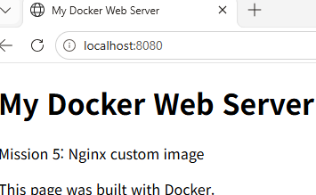
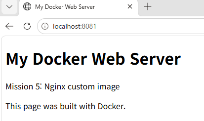
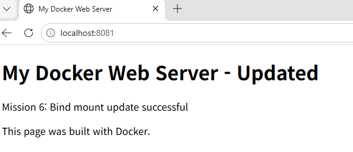
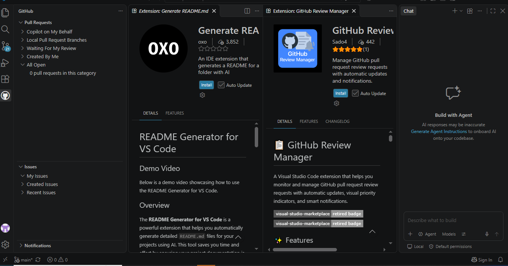
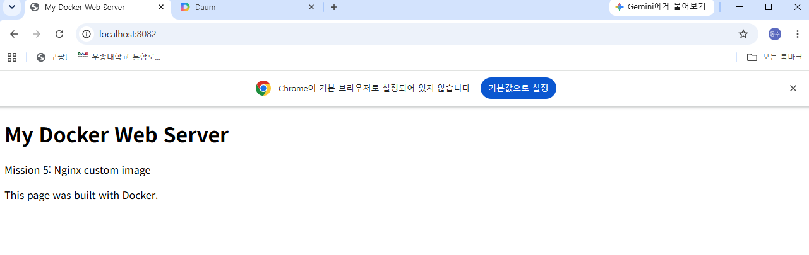
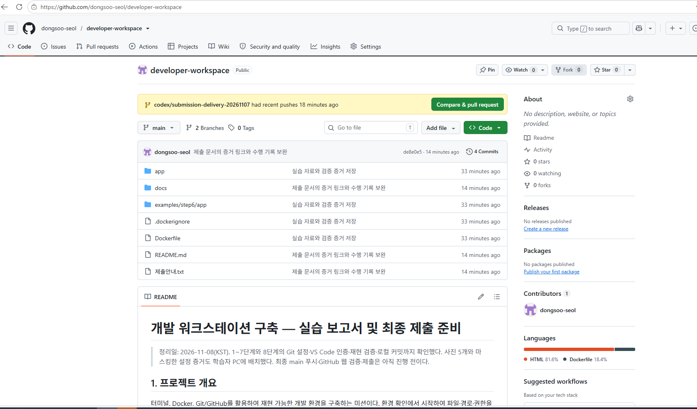

# 개발 워크스테이션 구축 — 실습 보고서 및 최종 제출 준비

> 정리일: 2026-11-08(KST). 1~7단계와 8단계의 Git 설정·VS Code 인증·재현 검증·로컬 커밋까지 확인했다. 사진 5개와 마스킹한 설정 증거도 학습자 PC에 배치했다. main 푸시(de8e0e5)와 GitHub의 파일·사진 표시를 확인했다. 최종 확인 문서와 저장소 화면을 추가 반영한 뒤 과제 제출처에 링크를 제출한다.

> **평가 항목 16 보완(2026-11-08):** 포트 충돌 재현 → 점유 PID·프로세스 확인 → 컨테이너 중지로 포트 해제 → 재생성 후 HTTP 200 검증을 [README의 단계별 기록](#evaluation-16-port-conflict)에 추가했다. 재평가 결과는 아직 확인 전이다.

## 1. 프로젝트 개요

터미널, Docker, Git/GitHub를 활용하여 재현 가능한 개발 환경을 구축하는 미션이다. 환경 확인에서 시작하여 파일·경로·권한을 익히고, 이후 웹 서버 컨테이너 제작과 네트워크·스토리지 연결, GitHub 공유까지 확장하는 것을 목표로 한다.

Windows에서 WSL2 Ubuntu를 사용해 Linux 기본 조작과 권한 변경을 수행했다. Docker는 버전·엔진 점검에 이어 이미지 확인, hello-world, Ubuntu 컨테이너 운영, 주 셸·exec·attach의 수명 비교까지 확인했다.

공식 Nginx 베이스에 직접 작성한 HTML을 추가한 mission-web:v1 이미지도 제작했다. 컨테이너 기동 로그, HTTP 200 응답과 본문, 브라우저 화면으로 웹 서버의 실제 동작을 확인했다.

## 2. 실행 환경

| 항목 | 실제 확인 결과 |
|---|---|
| 호스트 OS | Microsoft Windows 10 Pro, 10.0.19045 |
| 사용한 터미널·작업 창 | Windows PowerShell |
| Linux 환경 | WSL2 / Ubuntu 26.04.1 LTS |
| Ubuntu 기본 쉘 | Bash, `/bin/bash` |
| Windows Git | 2.56.0.windows.4 |
| Docker CLI | 29.9.2, build a82e528 |
| Docker 엔진 | 29.9.2, Docker Desktop / Linux 컨테이너 |
| Docker 데몬 점검 | Ubuntu의 docker info에서 Server 정보 수신 성공 |
| 웹 서버 베이스 | nginx:stable-alpine, 실제 Nginx 버전 1.30.6 |
| 커스텀 웹 서버 | mission-web:v1 / 컨테이너 mission-web / 포트 8080→80 |
| 2단계 실습 위치 | `/home/user/mission-step2` |
| 3단계 실습 위치 | `/home/user/mission-step3` |

[실행 환경 확인 명령과 실제 출력](docs/01-environment.md)

Git 버전은 Windows에서 확인한 결과이며, Ubuntu 안의 Git 설치 여부까지 증명하는 것은 아니다.

## 3. 전체 수행 체크리스트

- [x] 1단계: 실행 환경 및 Git·Docker 기본 점검
- [x] 2단계: 터미널 조작 및 절대·상대 경로 실습
- [x] 3단계: 파일·디렉터리 권한 변경 및 해석
- [x] 4단계: Docker 이미지·컨테이너 기본 운영, hello-world, Ubuntu 내부 실행
- [x] 5단계: Dockerfile 기반 커스텀 웹 서버 이미지 제작
- [x] 6단계: 포트 접속 및 바인드 마운트 변경 반영
- [x] 7단계: Docker 볼륨 데이터 영속성 검증
- [x] 8단계: Git 설정·GitHub·VS Code 연동·재현 검증·main 업로드
- [ ] 제출처에 저장소 링크 제출 및 평가자 접근 권한 확인

웹 서버 접속, 바인드 마운트 변경 반영, 컨테이너 삭제 후 볼륨 데이터 유지까지 확인했다. VS Code의 GitHub 인증과 로컬 커밋까지 확인했다. main 업로드와 GitHub 웹에서 파일·사진 표시도 확인했다.

## 4. 현재까지의 핵심 결과

### 4-1. 환경 점검

Git 명령 미인식 문제 이후 설치를 진행하고 버전 조회에 성공했다. Docker는 버전 조회와 별도로 Server 응답까지 확인했다.

**실제 확인 명령 — Windows PowerShell**

```powershell
git --version
```

**실제 출력**

```text
git version 2.56.0.windows.4
```

**실제 확인 명령 — Ubuntu**

```bash
docker --version
docker info
```

**버전 출력**

```text
Docker version 29.9.2, build a82e528
```

**docker info의 핵심 부분 발췌**

```text
Server Version: 29.9.2
Operating System: Docker Desktop
OSType: linux
```

[환경·Git·Docker 상세 검증 기록](docs/01-environment.md)

### 4-2. 터미널 및 경로 실습

전용 디렉터리에서 파일 생성·읽기·복사·이동·이름 변경·삭제를 수행하고 목록·내용으로 검증했다. 같은 파일을 서로 다른 위치에서 읽어 다음 차이를 확인했다.

| 현재 위치 | 같은 파일을 가리키는 상대 경로 | 절대 경로 |
|---|---|---|
| `/home/user/mission-step2` | `./notes.txt` | `/home/user/mission-step2/notes.txt` |
| `/home/user` | `mission-step2/notes.txt` | `/home/user/mission-step2/notes.txt` |

두 위치에서 동일한 두 줄을 확인했다. 상대 경로는 현재 위치에 따라 달라지지만 같은 파일의 절대 경로는 유지됐다.

[터미널 조작과 경로 비교 전체 기록](docs/02-terminal-paths.md)

### 4-3. 파일·디렉터리 권한 실습

초기 권한이 최종 목표와 같았으므로, 먼저 다른 권한으로 바꾼 뒤 되돌려 실제 변경 과정을 기록했다.

| 대상 | 최초 | 제한 후 | 파일만 재변경한 중간 상태 | 최종 |
|---|---|---|---|---|
| 파일 | 644 | 600 | 644 | 644 |
| 디렉터리 | 755 | 700 | 700 | 755 |

**최종 확인 명령**

```bash
ls -ld permission-file.txt permission-dir
```

**실제 출력**

```text
drwxr-xr-x 2 user user 4096 Nov  7 07:58 permission-dir
-rw-r--r-- 1 user user    0 Nov  7 07:57 permission-file.txt
```

[권한 변경 전후 전체 기록과 해석](docs/03-permissions.md)

### 4-4. Docker 운영과 컨테이너 수명 관찰

ubuntu:24.04를 최초로 가져올 때 Downloaded newer image 응답을 확인했고, 실습 후반에는 동일 digest에 대해 최신 상태라는 응답을 확인했다. hello-world는 실습 전후 각각 실행하여 성공 문구를 확인했다. mission4-ubuntu를 만들고 내부 명령, 실행·중지·재시작, 로그·리소스 조회를 수행했다.

| 수행 | 실제 확인 결과 |
|---|---|
| 주 Bash에서 exit | Exited (127). 직전 Docker 명령 미인식 로그로 원인 확인 |
| exec 추가 셸에서 exit | 주 프로세스는 유지되어 Up 2 minutes |
| attach 연결 후 분리 | 연결만 분리되어 Up 9 minutes |
| 명시적 stop 후 | Exited (137). 정확한 신호 처리 경로는 목록만으로 확정하지 않음 |
| 다시 start 후 | 동일 컨테이너가 Up 12 seconds |

리소스 조회 순간 CPU 0.00%, 메모리 1.039MiB / 3.786GiB를 확인했다.

[4단계 전체 기록](docs/04-docker-operations.md), [수명 비교표](docs/04-docker-operations.md#comparison)

[첨부 텍스트의 시간 순서별 실행 증거 — 컴퓨터명·내부 정보 마스킹](docs/evidence/04-docker-session.md)

### 4-5. 커스텀 Nginx 이미지와 웹 서버

공식 베이스 nginx:stable-alpine에서 Nginx 실행 환경을 활용하고, app/index.html을 웹 루트에 복사했다. 빌드 완료와 이미지 ID 3b4795625258을 확인했다. mission-web 컨테이너의 호스트 8080번 포트를 컨테이너 80번에 연결했다.

| 검증 | 실제 결과 |
|---|---|
| 빌드 | BuildKit FINISHED, mission-web:v1 생성 |
| 실행 | 컨테이너 28712a7251bb, Up 41 seconds |
| 로그 | nginx/1.30.6, worker 시작 |
| 기능 요청 | HTTP/1.1 200 OK, 직접 작성한 HTML 본문 |
| 브라우저 | localhost:8080 주소창과 My Docker Web Server 확인 |

[5단계 보고서](docs/05-custom-image.md), [전체 실행 증거](docs/evidence/05-web-session.md)

소스: [Dockerfile](Dockerfile), [HTML](app/index.html), [.dockerignore](.dockerignore)

브라우저 PNG는 학습자 PC의 docs/images에 배치했다. 보고서에서 이미지 파일을 직접 연결한다.

### 4-6. 포트 매핑과 바인드 마운트 검증

기존 5단계 컨테이너는 8080번을 사용하므로, 새 mission-web-bind를 8081번에 실행했다. 호스트의 /home/user/mission-step6/app을 웹 루트에 읽기 전용으로 연결하고, 호스트에서 HTML을 수정했다.

| 항목 | 수정 전 | 수정 후 |
|---|---|---|
| 주소 | localhost:8081 | localhost:8081 |
| 컨테이너 ID | 9ad4aaf662ba | 9ad4aaf662ba |
| 상태 | Up 35 seconds | Up 20 minutes |
| HTTP | 200 OK | 200 OK |
| Content-Length | 257 | 277 |
| 본문 | My Docker Web Server / Mission 5 | My Docker Web Server - Updated / Mission 6 |

제공된 명령 흐름에서 재빌드·재시작 없이 웹 응답이 바뀌었다. 컨테이너 내부 파일과 브라우저 화면에도 같은 내용이 반영됐다.

[6단계 보고서](docs/06-port-bind-mount.md), [전체 실행 증거](docs/evidence/06-bind-session.md), [수정 후 HTML](examples/step6/app/index.html)

수정 전후 PNG는 학습자 PC의 docs/images/06-bind-before.png와 06-bind-after.png에 배치한 것을 확인했고 6단계 보고서에서 직접 연결했다.

### 4-7. 이름 있는 볼륨 데이터 영속성

mission-data 볼륨에 파일을 저장한 첫 컨테이너를 삭제하고, 새 검증 컨테이너에 같은 볼륨을 읽기 전용으로 연결했다. 파일을 다시 작성하지 않고 이전 문장을 읽는 데 성공했다.

| 항목 | 첫 컨테이너 | 삭제 후 새 검증 컨테이너 |
|---|---|---|
| 이름 | mission7-first | mission7-verify |
| ID | 9a7353841aec | 83b287f14feb |
| 볼륨 | mission-data | mission-data |
| 연결 경로 | /data | /data |
| RW | true | false |
| 파일 내용 | Mission 7 persistent data | Mission 7 persistent data |

첫 컨테이너는 stop만 한 것으로 끝내지 않고 rm과 목록의 부재로 삭제를 확인했다. 삭제 후에도 볼륨이 남아 있음을 조회한 다음 새 컨테이너를 만들었다.

[7단계 상세 보고서](docs/07-volume-persistence.md), [삭제 증거](docs/07-volume-persistence.md#delete), [재연결·데이터 비교](docs/07-volume-persistence.md#comparison)

[7단계 전체 실행 기록](docs/evidence/07-volume-session.md)에는 두 회차가 있다. 최초 작성 컨테이너 2d37feccfaf1을 삭제한 뒤 a62ed3789c49에서 읽기에 성공했고, 후속 작성 컨테이너 9a7353841aec를 삭제한 뒤 83b287f14feb에서 읽기 전용 검증에도 성공했다. 위 표는 후속 회차를 기준으로 한다.

### 4-8. Git/GitHub 연결과 제출 소스 재현

Windows Git 작성자·기본 브랜치를 설정하고, 필수 설정 행을 발췌해 모든 값을 마스킹한 실제 출력 파일을 만들었다. 공식 GitHub Pull Requests 확장으로 인증 후 목록을 확인했다.

제출 저장소에서 mission-web:repro를 빌드해 8082번에서 HTTP 200과 맞춤 HTML·브라우저 화면을 확인했다. 재현용 컨테이너를 중지·삭제하고 PowerShell로 돌아왔다.

| 항목 | 실제 확인 결과 |
|---|---|
| 재현 컨테이너 | mission-web-repro, ffc5b7a375e8 |
| 응답 | HTTP 200, Content-Length 269, 직접 작성한 HTML |
| 로컬 커밋 | 1edb655 — 실습 자료와 검증 증거 저장 |
| 커밋 범위 | 28 files changed, 4975 insertions(+) |
| 문서 보완 커밋 | de8e0e5 — 제출 문서의 증거 링크와 수행 기록 보완 |
| 원격 게시 | main → main 푸시 성공, GitHub 파일·사진 표시 확인 |

[8단계 상세 보고서](docs/08-git-github-submission.md), [마스킹한 실제 설정 출력](docs/evidence/08-git-config-masked.txt)

## 5. 요구사항별 검증 방법 및 증거 위치

| 요구사항 | 검증 방법·판정 기준 | 실제 결과 위치 |
|---|---|---|
| OS·WSL·쉘 | OS 조회, WSL VERSION, 쉘 환경변수 확인 | [1단계](docs/01-environment.md) |
| Git 설치 | 설치 로그 이후 실제 버전 조회 성공 | [Git 점검](docs/01-environment.md#git) |
| Docker 설치·데몬 | 버전 확인과 Server 응답을 별도 확인 | [Docker 점검](docs/01-environment.md#docker) |
| 현재 위치·숨김 목록 | 현재 경로와 점으로 시작하는 항목 확인 | [목록 조회](docs/02-terminal-paths.md#log-01) |
| 디렉터리 생성·이동 | 생성 후 목록·현재 경로 확인 | [디렉터리 실습](docs/02-terminal-paths.md#log-02) |
| 빈 파일·내용 작성 | 크기 0 및 저장한 두 줄 확인 | [빈 파일](docs/02-terminal-paths.md#log-03), [내용 작성](docs/02-terminal-paths.md#log-05) |
| 복사·이동·이름 변경 | 원본·복사본·목적지의 목록과 내용 비교 | [복사](docs/02-terminal-paths.md#log-06), [이동](docs/02-terminal-paths.md#log-07), [이름 변경](docs/02-terminal-paths.md#log-08) |
| 삭제 | 삭제 전 존재와 삭제 후 부재 비교 | [삭제](docs/02-terminal-paths.md#log-09) |
| 절대·상대 경로 | 같은 파일의 내용을 위치별로 비교 | [경로 비교](docs/02-terminal-paths.md#log-10), [위치 변경](docs/02-terminal-paths.md#log-11) |
| 파일·디렉터리 권한 | 초기·중간·최종 문자 권한 비교 | [권한 비교표](docs/03-permissions.md#comparison) |
| 숫자 권한 해석 | r=4, w=2, x=1을 세 부류별로 계산 | [권한 해석](docs/03-permissions.md#concepts) |
| 이미지·hello-world | 최초 다운로드·후반 재사용·목록·실제 성공 문구 | [이미지](docs/04-docker-operations.md#images), [hello-world](docs/04-docker-operations.md#hello-world) |
| Ubuntu 내부 실행 | 대화형 Bash에서 ls·echo 수행 | [내부 명령](docs/04-docker-operations.md#main-shell) |
| 주 셸·exec·attach | 종료·분리 후 컨테이너 상태 비교 | [수명 비교](docs/04-docker-operations.md#comparison) |
| Docker 로그·리소스 | 실행 중 컨테이너에 logs·stats 수행 | [로그](docs/04-docker-operations.md#logs), [리소스](docs/04-docker-operations.md#stats) |
| Docker 중지·재시작 | stop·start 후 Exited·Up 확인 | [운영 기록](docs/04-docker-operations.md#stop-start) |
| 커스텀 베이스·소스 | 공식 출처·digest·HTML·Dockerfile 확인 | [베이스](docs/05-custom-image.md#base), [소스](docs/05-custom-image.md#source) |
| 웹 서버 빌드·실행 | 빌드 완료·이미지·컨테이너·로그 확인 | [빌드](docs/05-custom-image.md#build), [실행](docs/05-custom-image.md#run) |
| 웹 응답·브라우저 | HTTP 200과 맞춤 HTML, 주소창 포함 화면 | [HTTP](docs/05-custom-image.md#http), [화면 상태](docs/05-custom-image.md#browser) |
| 포트 충돌 진단·해제 | Windows PID·프로세스와 Docker 점유 대조, 중지 후 부재 확인, 재생성 후 실제 포트·HTTP 200 | [평가 항목 16 단계별 실행 기록](#evaluation-16-port-conflict), [별도 증거 문서](docs/evidence/16-port-conflict-session.md) |
| 바인드 연결 | inspect의 bind·Source·Destination·RW 확인 | [마운트 정보](docs/06-port-bind-mount.md#mount) |
| 변경 반영 | 호스트·컨테이너 파일, HTTP 본문, 화면 비교 | [수정 전후](docs/06-port-bind-mount.md#comparison) |
| 재생성 없이 유지 | 같은 ID, 이어지는 Up 시간, 실제 명령 흐름 | [컨테이너 확인](docs/06-port-bind-mount.md#identity) |
| 볼륨 생성·저장 | 이름·연결 경로·파일 작성 및 내용 조회 | [볼륨](docs/07-volume-persistence.md#volume), [삭제 전 데이터](docs/07-volume-persistence.md#write) |
| 삭제 후 데이터 유지 | 첫 컨테이너 삭제, 볼륨 존속, 새 ID에서 같은 내용 조회 | [삭제](docs/07-volume-persistence.md#delete), [새 컨테이너](docs/07-volume-persistence.md#verify), [읽기](docs/07-volume-persistence.md#read) |
| Git 설정·인증 | 마스킹 설정 파일, VS Code 인증 후 화면 | [설정](docs/08-git-github-submission.md#git-config), [VS Code](docs/08-git-github-submission.md#vscode) |
| 제출 소스 재현·정리 | 저장소 빌드·8082 응답·브라우저·stop/rm | [재현](docs/08-git-github-submission.md#reproduction), [정리](docs/08-git-github-submission.md#cleanup) |
| 로컬 커밋 | 28개 파일의 커밋 1edb655 확인 | [커밋 기록](docs/08-git-github-submission.md#local-commit) |
| 트러블슈팅 2건 이상 | 문제→가설→확인→해결/대안→재검증 | [트러블슈팅](docs/troubleshooting.md) |

## 6. 트러블슈팅 요약

| 문제 | 확인 및 해결 결과 | 상세 |
|---|---|---|
| PowerShell에서 Git 명령 미인식 | 설치 후 버전 출력 성공. 미설치와 PATH 중 최초 원인은 확정하지 않음 | [사례 1](docs/troubleshooting.md#issue-01) |
| 디렉터리 경로를 명령처럼 입력 | 디렉터리임을 확인하고 올바른 위치에서 후속 파일 작업 성공 | [사례 2](docs/troubleshooting.md#issue-02) |
| Windows에서 Linux 클라우드 경로로 이동 실패 | 환경별 경로가 다름을 확인. 이후 로컬 WSL 홈에서 실습했으나 같은 Windows 경로 재시도 성공 기록은 없음 | [추가 사례 3](docs/troubleshooting.md#issue-03) |
| 컨테이너 내부의 Docker 명령 미인식 | 로그로 원인 확인, WSL에서 다시 start·ps 성공 | [4단계 오류 분석](docs/04-docker-operations.md#troubleshooting) |

## 7. 학습한 핵심 개념

- Ubuntu는 Linux 기반 운영체제이며, 현재 PC에서는 WSL2로 실행한다.
- 파일은 내용을 담고, 디렉터리는 파일과 하위 디렉터리를 정리한다.
- 절대 경로는 최상위 디렉터리에서, 상대 경로는 현재 위치에서 시작한다.
- 파일과 디렉터리는 같은 r/w/x 표기를 사용하지만 각 권한의 의미가 다르다.
- 스크립트는 명령을 순서대로 적어 실행하는 파일이다. 이번 기록에는 스크립트 작성·실행 실습은 포함되지 않는다.
- 이름 있는 볼륨은 컨테이너와 별도로 데이터를 유지한다. 이번에는 컨테이너 삭제 후 재연결로 확인했으며, 이를 별도 복사본을 만드는 백업과 구분했다.

[사례로 정리한 개념 복습 노트](docs/learning-notes.md)

## 8. 문서 구성

```text
README.md
Dockerfile
.dockerignore
app/
└── index.html
examples/
└── step6/
    └── app/
        └── index.html
제출안내.txt
docs/
├── 01-environment.md
├── 02-terminal-paths.md
├── 03-permissions.md
├── 04-docker-operations.md
├── 05-custom-image.md
├── 06-port-bind-mount.md
├── 07-volume-persistence.md
├── 08-git-github-submission.md
├── evidence/
│   ├── 04-docker-session.md
│   ├── 05-web-session.md
│   ├── 06-bind-session.md
│   ├── 07-volume-session.md
│   └── 08-git-config-masked.txt
├── images/
│   ├── 05-web-access.png
│   ├── 06-bind-before.png
│   ├── 06-bind-after.png
│   ├── 08-vscode-github.png
│   ├── 08-repro-web.png
│   └── 이미지추가안내.txt
├── troubleshooting.md
├── learning-notes.md
└── submission-checklist.md
```

실습용 파일의 원본은 로컬 Ubuntu의 홈 디렉터리에 있다. 이 묶음의 5단계 HTML·Dockerfile·.dockerignore는 실제 cat 출력 내용으로 저장했다. 전체 로컬 파일시스템을 복사한 백업은 아니다.

## 9. 보안 및 기록 원칙

- 토큰·비밀번호·개인키·인증 코드를 포함하지 않았다.
- 개인 컴퓨터명, 내부 주소·식별자, 실습에 불필요한 설정 경로는 생략했다.
- 발췌 출력과 개념 설명용 예시를 실제 실행 로그와 구분했다.
- 실제로 수행하지 않은 컨테이너 실행·접속·인증 결과를 만들지 않았다.
- 다른 사용자 계정으로 접근 차단을 시험한 기록은 없으므로, 권한 실험은 소유자의 권한 변경과 표시 확인 범위로 보고했다.

## 10. 원격 게시 결과와 제출 절차

실습 자료를 1edb655로 보관한 뒤 문서 보완 커밋 de8e0e5를 main에 푸시했다. 실제 출력은 `f89744e..de8e0e5 main -> main`이다. 학습자는 GitHub에서 파일과 사진이 모두 보이는 것을 확인했다. [실제 푸시 출력과 게시 확인](docs/08-git-github-submission.md#publication)에 근거를 기록했다.

최종 확인 기록과 저장소 화면을 커밋·푸시한 뒤, 과제 제출 규칙에 맞는 공개 또는 평가자 접근 권한을 확인하고 아래 링크를 제출한다.

제출 대상: https://github.com/dongsoo-seol/developer-workspace

과제 제출처에 링크를 등록하는 절차는 GitHub 업로드와 별개이다. [제출 점검표](docs/submission-checklist.md)를 함께 확인한다.

## 11. 웹 서버 재현 방법 — 새 환경용

아래는 동일 소스가 있는 새 작업 환경에서 사용하는 재현용 명령이다. 기존에 mission-web이 실행 중이면 이름·포트가 이미 사용 중일 수 있으므로 이 명령을 그대로 반복할 필요는 없다.

Dockerfile과 app 폴더가 있는 저장소 루트에서 실행한다.

```bash
docker build -t mission-web:v1 .
docker run -d --name mission-web -p 8080:80 mission-web:v1
curl -i http://localhost:8080
```

확인 기준은 HTTP 200과 My Docker Web Server 문구이다. 원래 빌드는 stable-alpine 태그를 사용했으며 실제 digest는 5단계 보고서에 기록했다. 나중에 태그가 갱신될 수 있으므로 비트 단위로 동일한 베이스가 자동 보장되는 것은 아니다.


## 12. 실제 증거 화면

### 5단계 웹 서버



### 6단계 바인드 마운트 수정 전후





### 8단계 GitHub 연결과 재현





### GitHub 저장소 게시 확인




<a id="evaluation-16-port-conflict"></a>

## 13. 평가 항목 16 보완 — 포트 충돌 진단·해제·재검증

**평가에서 요청한 보완:** 포트 충돌 시 점유 프로세스 확인과 포트 해제 절차를 실제 명령·출력과 함께 단계별로 기록한다. 아래는 2026-11-08 Windows PowerShell / Docker Desktop에서 학습자가 수행한 결과이다. 관련 출력만 발췌했고 출력이 없던 조회는 본문에 명시했다.

**핵심 결과:** mission-web의 8080 점유와 Windows의 PID 14720(wslrelay)·12572(com.docker.backend)를 확인했다. mission-web을 중지하자 Docker·Windows 조회에서 점유가 없어졌고, 검증용 컨테이너를 재생성한 뒤 실제 8080→80 연결과 HTTP 200을 확인했다. PID는 당시 값이며 재실행 시 달라질 수 있다.

[별도 실행 증거 문서](docs/evidence/16-port-conflict-session.md)에서도 같은 과정을 확인할 수 있다. Docker Desktop·WSL 중계 프로세스를 강제 종료하지 않고, Docker 목록에서 식별한 해당 컨테이너를 중지했다.

### 13-1. 초기 상태와 8080 포트 점유 준비

```powershell
docker ps
Get-NetTCPConnection -LocalPort 8080 -State Listen -ErrorAction SilentlyContinue | Select-Object LocalAddress,LocalPort,OwningProcess
```

처음 docker ps에는 제목 행만 나왔고, Windows 조회에서도 항목이 없었다. 이어 docker ps -a에서 기존 mission-web(28712a7251bb)의 중지 상태와 8080 설정을 확인했다.

```powershell
docker start mission-web
```

```text
mission-web
```

```powershell
docker ps
```

해당 행에서 확인한 실제 값 발췌:

```text
CONTAINER ID: 28712a7251bb
IMAGE: mission-web:v1
STATUS: Up 13 seconds
PORTS: 0.0.0.0:8080->80/tcp, [::]:8080->80/tcp
NAMES: mission-web
```

위는 표 전체의 원형이 아니라 관련 행의 값을 항목별로 발췌한 것이다.

### 13-2. 같은 포트 사용으로 충돌 재현

```powershell
docker run -d --name mission16-conflict -p 8080:80 mission-web:v1
```

생성된 컨테이너 ID:

```text
e0cfe5e5a7581bef24764df49d0d62d88a2677bf647e7e6159a6388729804e88
```

오류 메시지의 핵심 부분:

```text
Bind for 0.0.0.0:8080 failed: port is already allocated
```

컨테이너 ID가 출력됐지만 네트워크 연결은 실패했다. 기존 mission-web이 사용 중인 호스트 8080을 새 컨테이너에도 지정한 것이 충돌 재현 조건이다.

### 13-3. Windows 점유 PID와 프로세스 이름 확인

```powershell
Get-NetTCPConnection -LocalPort 8080 -State Listen | Select-Object LocalAddress,LocalPort,OwningProcess
```

```text
LocalAddress LocalPort OwningProcess
------------ --------- -------------
::1               8080         14720
::                8080         12572
127.0.0.1         8080         14720
```

```powershell
Get-NetTCPConnection -LocalPort 8080 -State Listen | Select-Object -ExpandProperty OwningProcess -Unique | ForEach-Object { Get-Process -Id $_ } | Select-Object Id,ProcessName
```

```text
   Id ProcessName
   -- -----------
14720 wslrelay
12572 com.docker.backend
```

OwningProcess는 수신 중인 항목의 Windows PID이다. 해당 PID의 이름은 WSL·Docker Desktop 관련 중계 프로세스였고, Docker 목록에서는 mission-web의 8080 공개를 확인했다. 두 종류의 조회를 함께 사용해 컨테이너와 호스트의 점유를 진단했다. PID는 당시 값이므로 재실행 시 달라질 수 있다.

### 13-4. 점유 컨테이너 중지와 포트 해제 확인

Docker Desktop 기반 프로세스를 강제 종료하지 않고, 점유 대상으로 확인한 컨테이너만 중지했다.

```powershell
docker stop mission-web
```

```text
mission-web
```

```powershell
docker ps --filter publish=8080
```

```text
CONTAINER ID   IMAGE     COMMAND   CREATED   STATUS    PORTS     NAMES
```

```powershell
Get-NetTCPConnection -LocalPort 8080 -State Listen -ErrorAction SilentlyContinue | Select-Object LocalAddress,LocalPort,OwningProcess
```

마지막 조회는 항목 출력 없이 다음 PowerShell 입력 줄로 돌아왔다. Docker의 실행 중 포트 공개 목록과 Windows의 Listen 조회 모두에서 8080 점유가 없어졌음을 확인했다.

### 13-5. 단순 재시작 후에도 실제 포트가 연결되지 않은 중간 결과

```powershell
docker start mission16-conflict
```

```text
mission16-conflict
```

```powershell
docker ps --filter name=mission16-conflict
```

관련 행의 실제 값 발췌:

```text
CONTAINER ID: e0cfe5e5a758
STATUS: Up 12 seconds
PORTS: 80/tcp
NAMES: mission16-conflict
```

```powershell
curl.exe -i http://localhost:8080
```

```text
curl: (7) Failed to connect to localhost port 8080 after 2256 ms: Could not connect to server
```

```powershell
docker port mission16-conflict
```

위 docker port 조회는 출력 없이 다음 입력 줄로 돌아왔다.

```powershell
docker inspect --format '{{json .HostConfig.PortBindings}}' mission16-conflict
```

```json
{"80/tcp":[{"HostIp":"","HostPort":"8080"}]}
```

설정에는 8080→80이 남아 있었지만 실제 공개 포트는 표시되지 않았고 HTTP 접속도 실패했다. 관찰한 사실을 기록하되 Docker 내부에서 이 상태가 발생한 구체적인 원인은 단정하지 않는다. 이번에는 재생성으로 해결했다. Up 표시만으로 포트 연결 성공을 판단할 수 없음을 확인했다.

### 13-6. 실습 컨테이너 재생성으로 포트 연결 복구

이번에 만든 mission16-conflict는 이미지의 정적 페이지를 제공하는 검증용 컨테이너이므로 해당 컨테이너만 중지·삭제하고 재생성했다. 기존 mission-web이나 볼륨은 삭제하지 않았다. 보존할 쓰기 계층 데이터가 있는 일반 컨테이너에 그대로 적용하는 절차는 아니다.

```powershell
docker stop mission16-conflict
```

```text
mission16-conflict
```

```powershell
docker rm mission16-conflict
```

```text
mission16-conflict
```

```powershell
docker run -d --name mission16-conflict -p 8080:80 mission-web:v1
```

```text
2778a1811e05ffebe4f9562809841b027cca236d8b689728cc5c132529915c7d
```

```powershell
docker port mission16-conflict
```

```text
80/tcp -> 0.0.0.0:8080
80/tcp -> [::]:8080
```

```powershell
curl.exe -i http://localhost:8080
```

실제 응답:

```http
HTTP/1.1 200 OK
Server: nginx/1.30.6
Date: Sun, 08 Nov 2026 12:23:39 GMT
Content-Type: text/html
Content-Length: 257
Last-Modified: Sat, 07 Nov 2026 01:27:14 GMT
Connection: keep-alive
ETag: "6aee7e72-101"
Accept-Ranges: bytes

<!doctype html>
<html lang="ko">
<head>
    <meta charset="utf-8">
    <title>My Docker Web Server</title>
</head>
<body>
    <h1>My Docker Web Server</h1>
    <p>Mission 5: Nginx custom image</p>
    <p>This page was built with Docker.</p>
</body>
</html>
```

### 13-7. 판정과 실습 종료 시점 상태

- 충돌 재현: 같은 호스트 8080 사용 요청에서 port is already allocated 확인.
- 점유 진단: Docker의 mission-web 포트와 Windows PID·프로세스 이름을 함께 확인.
- 포트 해제: mission-web 중지 뒤 Docker 목록과 Windows Listen 조회의 점유 부재 확인.
- 중간 실패: 최초 충돌 컨테이너를 start해도 실제 공개 포트가 없고 HTTP 연결 실패.
- 복구: 실습 컨테이너만 재생성하고 실제 8080→80 공개, HTTP 200과 직접 작성한 HTML 확인.
- 종료 시점: mission-web은 중지, 새 mission16-conflict(2778a1811e05...)는 8080에 실행 중이다. 그 이후 정리·원상복구까지 수행했다고 기록하지 않는다.

아래는 추가 정리가 필요할 때의 안내이며, 위 실행 로그에 포함된 완료 작업은 아니다. 기록을 모두 저장한 뒤 필요에 따라 수행한다.

```powershell
docker stop mission16-conflict
docker rm mission16-conflict
docker start mission-web
docker port mission-web
curl.exe -i http://localhost:8080
```

기존 컨테이너나 프로세스를 임의 종료할 수 없는 상황에는 다른 빈 호스트 포트를 선택하는 대안이 있다. 예를 들어 -p 8083:80으로 실행하려면 먼저 8083의 점유도 조회해야 한다. 이 대안은 이번 실행 성공 증거가 아니라 대응 방법 설명이다.
