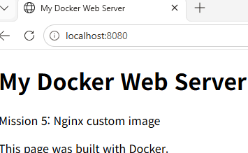

# 5단계. 공식 Nginx 베이스를 활용한 커스텀 웹 서버 이미지 제작

## 1. 목표와 결과

공식 Nginx 이미지에 직접 작성한 HTML을 복사하여 커스텀 이미지를 만들고, 컨테이너에서 실행했다. 컨테이너 상태와 기동 로그뿐 아니라 HTTP 응답·본문과 Windows 브라우저 화면으로 실제 웹 서버 동작을 확인했다.

| 항목 | 실제 확인 결과 |
|---|---|
| 작업 위치 | `/home/user/mission-step5` |
| 베이스 이미지 | `nginx:stable-alpine` |
| 베이스 식별 정보 | `nginx@sha256:583b7f2fce1cdb8da5ad5c39ebd3c33b98b87d493190e548bdee1fa8c619c311` |
| 확인된 Nginx 버전 | 1.30.6 — 기동 로그·HTTP Server 헤더 |
| 커스텀 이미지 | `mission-web:v1`, ID `3b4795625258` |
| 컨테이너 | `mission-web`, ID `28712a7251bb` |
| 포트 연결 | 호스트 8080 → 컨테이너 80 |
| 기능 검증 | HTTP 200 OK, 작성한 HTML 응답, 브라우저의 맞춤 페이지 |

기록 기준은 학습자가 로컬 PC에서 제공한 실제 로그이다. [전체 실행 증거](evidence/05-web-session.md)에 명령·출력 순서를 보존했다. 긴 출력의 발췌 사실을 표시했으며, 실행되지 않은 예시와 실제 결과를 구분했다.

빌드 성공 출력은 첨부 로그에 있지만 그 앞의 빌드 명령 입력 줄은 빠져 있다. 따라서 이 문서에서는 빌드 명령을 재현용으로 표시하고, 실제 성공 여부는 BuildKit 출력과 이미지 목록으로 확인한다.

<a id="verification"></a>

## 2. 요구사항 및 증거

| 완료 | 요구사항 | 증거 |
|---|---|---|
| [x] | 공식 베이스·태그 선택과 출처 | [베이스](#base) |
| [x] | 직접 작성한 HTML과 Dockerfile | [소스](#source) |
| [x] | 커스텀 항목과 목적 | [변경 설명](#customization) |
| [x] | 이미지 빌드 성공 | [빌드 결과](#build) |
| [x] | 컨테이너 실행 성공 | [실행·로그](#run) |
| [x] | 실제 웹 서버 응답 | [curl 검증](#http) |
| [x] | 주소창 포함 브라우저 화면 확인 | [화면 증거 상태](#browser) |
| [x] | FROM·COPY·재빌드 개념 | [해석](#concepts) |

브라우저 화면을 확인했고, 이후 학습자 PC의 docs/images/05-web-access.png에 실제 파일을 배치한 결과도 확인했다. 아래 화면 링크는 저장소에서 이미지 파일과 함께 게시한다.

<a id="base"></a>

## 3. 베이스 선택과 다운로드

Nginx가 설치되고 실행 설정도 준비된 공식 이미지를 선택했다. 웹 서버를 처음부터 설치하는 대신 정적 콘텐츠를 교체하는 방식이다.

- 공식 이미지 사용 안내: https://hub.docker.com/_/nginx
- 공식 이미지 Dockerfile 저장소: https://github.com/nginx/docker-nginx
- 선택한 태그: nginx:stable-alpine

**실제 실행 명령**

```bash
docker pull nginx:stable-alpine
```

**실제 출력 중 결과 발췌**

```text
Digest: sha256:583b7f2fce1cdb8da5ad5c39ebd3c33b98b87d493190e548bdee1fa8c619c311
Status: Downloaded newer image for nginx:stable-alpine
docker.io/library/nginx:stable-alpine
```

**실제 식별 정보 조회 명령**

```bash
docker image inspect --format '{{index .RepoDigests 0}}' nginx:stable-alpine
```

**실제 출력**

```text
nginx@sha256:583b7f2fce1cdb8da5ad5c39ebd3c33b98b87d493190e548bdee1fa8c619c311
```

stable-alpine은 갱신될 수 있는 태그이다. 실제 사용한 digest를 함께 보관하여 어떤 베이스로 빌드했는지 식별할 수 있게 했다. 제출된 Dockerfile은 실제 작성했던 태그 사용 방식 그대로이며, digest로 고정한 Dockerfile로 바꿔 작성했다고 주장하지 않는다.

<a id="source"></a>

## 4. 작성 파일과 내용

제출용 소스 파일은 실제 cat 출력 내용을 그대로 저장했다. [Dockerfile](../Dockerfile), [HTML](../app/index.html), [.dockerignore](../.dockerignore)를 저장소 루트에서 함께 확인할 수 있다.

### 4-1. HTML

**실제 확인 명령**

```bash
cat app/index.html
```

**실제 내용**

```html
<!doctype html>
<html lang="ko">
<head>
    <meta charset="utf-8">
    <title>My Docker Web Server</title>
</head>
<body>
    <h1>My Docker Web Server</h1>
    <p>Mission 5: Nginx custom image</p>
    <p>This page was built with Docker.</p>
</body>
</html>
```

### 4-2. Dockerfile

**실제 확인 명령**

```bash
cat Dockerfile
```

**실제 내용**

```dockerfile
FROM nginx:stable-alpine
COPY app/ /usr/share/nginx/html/
```

### 4-3. Docker 빌드 제외 설정

**실제 확인 명령**

```bash
cat .dockerignore
```

**실제 내용**

```text
.git
docs
*.log
README.md
```

Git 관리 정보, 보고서, 로그, 안내 문서를 빌드 컨텍스트에서 제외한다. 원본 파일을 삭제하는 설정은 아니며, Git 커밋 제외 설정인 .gitignore와도 다르다. 웹 콘텐츠인 app은 제외하지 않아 COPY 대상으로 사용할 수 있다.

<a id="customization"></a>

## 5. 커스텀 포인트와 목적

| 적용 내용 | 목적 | 확인 결과 |
|---|---|---|
| 공식 Nginx 베이스 사용 | 이미 준비된 웹 서버와 기본 실행 설정 활용 | FROM 및 빌드의 베이스 digest |
| 기본 index.html 대신 직접 작성한 페이지 복사 | 기본 환영 화면을 미션 전용 페이지로 교체 | HTTP 본문·브라우저의 My Docker Web Server |
| UTF-8·문서 제목·페이지 문구 지정 | 문서 문자 인코딩과 미션 식별 정보 명시 | HTML 원문 및 응답 |
| .dockerignore 작성 | 불필요한 문서·로그 등의 빌드 전송 제외 | cat 내용 및 빌드의 .dockerignore 로드 |

별도 Nginx 설정 파일이나 자체 시작 명령은 추가하지 않았다. 베이스 이미지가 제공하는 기본 웹 루트와 시작 설정을 그대로 활용하고 정적 콘텐츠를 교체했다.

<a id="build"></a>

## 6. 이미지 빌드

**재현용 빌드 명령 — 실행 입력 줄 자체는 첨부 기록에서 누락됨**

Dockerfile이 있는 디렉터리에서 사용하는 명령이다.

```bash
docker build -t mission-web:v1 .
```

**제공된 실제 빌드 출력 중 핵심 부분 발췌**

```text
[+] Building 3.5s (7/7) FINISHED
 => [internal] load build definition from Dockerfile
 => [internal] load metadata for docker.io/library/nginx:stable-alpine
 => [internal] load .dockerignore
 => [1/2] FROM docker.io/library/nginx:stable-alpine@sha256:583b7f2fce1cdb8da5ad5c39ebd3c33b98b87d493190e548bdee1fa8c619c311
 => [2/2] COPY app/ /usr/share/nginx/html/
 => exporting to image
 => => naming to docker.io/library/mission-web:v1
 => => unpacking to docker.io/library/mission-web:v1
```

표시 간격과 각 행의 소요 시간은 생략했다. 전체 출력은 실행 증거 문서에 있다.

**실제 이미지 확인 명령**

```bash
docker images mission-web
```

**실제 이미지 행**

```text
mission-web:v1   3b4795625258   92.7MB   26.1MB
```

빌드 완료 표시, 이미지 이름 지정, 이미지 목록을 함께 확인하여 빌드 성공으로 판정했다.

<a id="run"></a>

## 7. 컨테이너 실행과 기동 로그

**실제 실행 명령**

```bash
docker run -d --name mission-web -p 8080:80 mission-web:v1
```

**실제 출력**

```text
28712a7251bb41dafea19baee9f09cad975f51a0eacf9e81ed0370ab715e808f
```

**실제 확인 명령**

```bash
docker ps
```

**해당 컨테이너 행 발췌**

```text
28712a7251bb   mission-web:v1   "/docker-entrypoint.…"   45 seconds ago   Up 41 seconds   0.0.0.0:8080->80/tcp, [::]:8080->80/tcp   mission-web
```

호스트 8080번 포트를 컨테이너의 Nginx 80번 포트로 연결했다. d 옵션은 백그라운드 실행, name은 컨테이너 이름 지정이다.

**실제 로그 조회**

```bash
docker logs mission-web
```

**기동 로그 중 발췌**

```text
/docker-entrypoint.sh: Configuration complete; ready for start up
2026/11/07 01:33:48 [notice] 1#1: nginx/1.30.6
2026/11/07 01:33:48 [notice] 1#1: start worker processes
```

로그의 시각 표기는 원문대로 보관했다. Up 상태와 기동 로그는 실행 확인이고, 실제 서비스 동작은 다음 HTTP 응답으로 별도 확인했다.

<a id="http"></a>

## 8. HTTP 응답으로 기능 검증

**실제 실행 명령**

```bash
curl -i http://localhost:8080
```

**실제 응답 헤더**

```text
HTTP/1.1 200 OK
Server: nginx/1.30.6
Date: Sat, 07 Nov 2026 01:50:43 GMT
Content-Type: text/html
Content-Length: 257
Last-Modified: Sat, 07 Nov 2026 01:27:14 GMT
Connection: keep-alive
ETag: "6aee7e72-101"
Accept-Ranges: bytes
```

**실제 응답 본문**

```html
<!doctype html>
<html lang="ko">
<head>
    <meta charset="utf-8">
    <title>My Docker Web Server</title>
</head>
<body>
    <h1>My Docker Web Server</h1>
    <p>Mission 5: Nginx custom image</p>
    <p>This page was built with Docker.</p>
</body>
</html>
```

**판정:** HTTP 200 성공 응답과 함께 직접 작성한 제목과 문구가 응답에 포함됐다. 단순히 포트가 열렸다는 사실보다 강한 기능 검증 근거이다. 응답 Date의 01:50:43 GMT는 한국 시각으로 10:50:43 KST이다.

<a id="browser"></a>

## 9. 브라우저 접속 증거

주소창 localhost:8080과 My Docker Web Server 제목, Mission 5 문구가 함께 보이는 실제 화면을 확인했다. 이후 해당 이미지가 학습자 PC의 저장소 docs/images에 17,344바이트 파일로 배치된 것을 확인했다.



6단계는 별도 컨테이너와 8081번 포트로 바인드 마운트를 검증했다. [수정 전후 기록](06-port-bind-mount.md#comparison)과 이 5단계 화면을 구분한다.

<a id="concepts"></a>

## 10. Dockerfile과 재빌드 개념

| 항목 | 의미 |
|---|---|
| FROM | 베이스 이미지의 파일시스템과 기본 설정을 활용 |
| COPY | 빌드 컨텍스트의 app 내용을 이미지의 웹 루트로 복사 |
| 빌드 명령 마지막 점 | 현재 디렉터리를 빌드 컨텍스트로 지정 |
| 이미지 이름·태그 | 이번 커스텀 이미지는 mission-web:v1 |
| 컨테이너 이름 | 이번 실행 인스턴스는 mission-web |

이번 방식은 빌드할 때 HTML을 이미지에 복사한다. 따라서 호스트의 HTML이나 Dockerfile을 수정한 것만으로 실행 중인 컨테이너가 자동 변경되지는 않는다. 변경을 반영하려면 새 이미지를 빌드하고 그 이미지로 컨테이너를 새로 만들어야 한다. 동일 태그를 다시 빌드해도 기존 컨테이너의 파일시스템이 자동 교체되는 것은 아니다.

이후 바인드 마운트 실습은 호스트 파일을 연결하여 변경을 확인하는 별도의 방식이다.

## 11. 완료 상태와 제출 보완 사항

- [x] 베이스 이미지·태그·digest·공식 출처 기록
- [x] 실제 HTML·Dockerfile·.dockerignore 확인 및 제출용 소스 저장
- [x] 커스텀 항목과 목적 설명
- [x] 빌드 성공 출력과 이미지 목록 확인
- [x] 컨테이너 실행 및 기동 로그 확인
- [x] HTTP 성공 응답과 작성한 본문 확인
- [x] 대화에 첨부된 주소창 포함 브라우저 화면 확인
- [x] 원본 PNG를 제출 폴더에 넣고 문서에 이미지 링크 추가

5단계 기능 실습과 로컬 이미지 파일 배치를 확인했다. 최종 GitHub 게시 후에도 이미지 표시를 확인한다. 재실행 안내의 명령을 기존 컨테이너가 있는 상태에서 무조건 반복할 필요는 없다. 새 환경에서 재현할 때 사용하고, 이름이나 포트 충돌이 있으면 기존 실행 상태를 확인한다.
