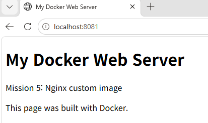
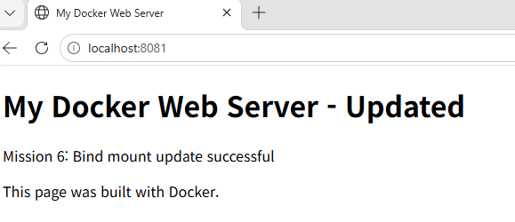

# 6단계. 포트 매핑 및 바인드 마운트 변경 반영 검증

## 1. 목표와 기록 기준

5단계에서 만든 이미지를 다시 빌드하지 않고 재사용하여, 호스트의 HTML 디렉터리를 연결한 새 컨테이너를 실행했다. 같은 접속 주소에서 파일 수정 전후 응답을 비교하고, 컨테이너 내부 파일·브라우저 화면·실행 상태로 결과를 검증했다.

실습일은 2026-11-07(KST)이다. 아래 기록은 학습자가 로컬 WSL2 Ubuntu에서 제공한 실제 명령·출력이다. 개인 컴퓨터명은 제거했고, 긴 출력은 발췌 사실을 표시했다. [첨부 텍스트 전체 실행 기록](evidence/06-bind-session.md)에 오류를 포함한 시간 순서를 보존했다.

수정 전후 브라우저 화면을 확인했고, 이후 원본 PNG 두 개가 학습자 PC의 저장소 docs/images에 배치된 결과도 확인했다. 문서에서 실제 파일을 연결한다.

## 2. 환경과 연결 구성

| 항목 | 실제 값 |
|---|---|
| 호스트 환경 | Windows 10 Pro / WSL2 Ubuntu 26.04.1 LTS / Bash |
| 작업 위치 | `/home/user/mission-step6` |
| 이미지 | `mission-web:v1` — 5단계 이미지 재사용 |
| 컨테이너 | `mission-web-bind` |
| 컨테이너 ID | `9ad4aaf662ba` |
| 포트 | 호스트 8081 → 컨테이너 80 |
| 호스트 소스 | `/home/user/mission-step6/app` |
| 컨테이너 연결 위치 | `/usr/share/nginx/html` |
| 마운트 | bind, readonly |

기존 5단계 컨테이너 mission-web은 8080번을 사용하고 있어, 이번 컨테이너에는 8081번을 사용했다. 두 실습의 이름·포트를 구분해 충돌을 피했다.

<a id="verification"></a>

## 3. 요구사항별 완료 증거

| 완료 | 요구사항 | 실제 검증·증거 |
|---|---|---|
| [x] | 포트 매핑 실행 | [실행 명령과 상태](#run) |
| [x] | HTTP 응답 | [수정 전 200](#before), [수정 후 200](#after) |
| [x] | 주소창 포함 화면 | [브라우저 확인](#screenshots) |
| [x] | 바인드 마운트 연결 | [inspect의 Type·Source·Destination·RW](#mount) |
| [x] | 호스트 HTML 수정 | [수정 전 파일과 수정 과정](#edit) |
| [x] | 컨테이너에서 수정 내용 확인 | [exec로 파일 읽기](#container-file) |
| [x] | 재빌드 없이 응답 변경 | [비교표와 제공된 명령 흐름](#comparison) |
| [x] | 같은 컨테이너 유지 | [수정 전후 ID·실행 시간](#identity) |

<a id="setup"></a>

## 4. 실습 폴더와 HTML 준비

초기에는 폴더가 없는데 이동을 시도했고 컨테이너 생성 명령도 오타로 실패했다. 진단 결과와 해결은 [트러블슈팅](#troubleshooting)에 별도로 기록했다. 정상적으로 준비한 명령은 다음과 같다.

```bash
mkdir -p ~/mission-step6/app
cp ~/mission-step5/app/index.html ~/mission-step6/app/index.html
cd ~/mission-step6
pwd
```

**실제 pwd 출력**

```text
/home/user/mission-step6
```

**실제 파일 확인**

```bash
cat app/index.html
```

**실제 내용 중 본문 발췌**

```html
<body>
    <h1>My Docker Web Server</h1>
    <p>Mission 5: Nginx custom image</p>
    <p>This page was built with Docker.</p>
</body>
```

전체 수정 전 내용은 5단계의 [app/index.html](../app/index.html)과 같았다. 수정 전 HTTP 응답에서도 같은 내용을 확인했다.

<a id="run"></a>

## 5. 포트·바인드 마운트를 적용한 실행

**실제 실행 명령**

```bash
docker run -d --name mission-web-bind -p 8081:80 --mount type=bind,source=/home/user/mission-step6/app,target=/usr/share/nginx/html,readonly mission-web:v1
```

**실제 출력**

```text
9ad4aaf662ba4518ba57dade2ed7e63246966f08ed1782b56f211cea89a92215
```

**상태 조회**

```bash
docker ps
```

**실제 목록 중 해당 행 발췌**

```text
9ad4aaf662ba   mission-web:v1   "/docker-entrypoint.…"   36 seconds ago   Up 35 seconds   0.0.0.0:8081->80/tcp, [::]:8081->80/tcp   mission-web-bind
```

실행 상태와 호스트 8081번 연결을 확인했다.

<a id="mount"></a>

## 6. 실제 마운트 정보 확인

**실제 실행 명령**

```bash
docker inspect --format '{{json .Mounts}}' mission-web-bind
```

**실제 출력**

```json
[{"Type":"bind","Source":"/home/user/mission-step6/app","Destination":"/usr/share/nginx/html","Mode":"","RW":false,"Propagation":"rprivate"}]
```

| 값 | 해석 |
|---|---|
| Type=bind | 호스트 경로를 연결한 바인드 마운트 |
| Source | WSL Ubuntu에서 준비한 HTML 폴더 |
| Destination | Nginx가 웹 콘텐츠를 읽는 컨테이너 경로 |
| RW=false | 컨테이너 관점에서 읽기 전용 |

Mode 필드는 실제로 빈 문자열이었다. 읽기 전용 여부는 RW=false로 확인했다. 읽기 전용 마운트는 컨테이너의 쓰기를 제한하는 것이며 호스트 소유자의 파일 수정까지 막는 것은 아니다. 실제로 이후 호스트 수정이 성공했다.

<a id="before"></a>

## 7. 수정 전 HTTP 응답과 화면

**실제 실행 명령**

```bash
curl -i http://localhost:8081
```

**실제 응답 헤더**

```text
HTTP/1.1 200 OK
Server: nginx/1.30.6
Date: Sat, 07 Nov 2026 02:51:24 GMT
Content-Type: text/html
Content-Length: 257
Last-Modified: Sat, 07 Nov 2026 02:45:53 GMT
Connection: keep-alive
ETag: "6aee90e1-101"
Accept-Ranges: bytes
```

**실제 본문 중 발췌**

```html
<h1>My Docker Web Server</h1>
<p>Mission 5: Nginx custom image</p>
```

대화에 첨부된 수정 전 브라우저 화면에서도 localhost:8081 주소창과 같은 문구를 확인했다.

<a id="edit"></a>

## 8. 호스트 HTML 수정

처음 nano 편집에서는 제목이 파일 맨 앞에 세 번 추가되고 기존 문장이 남았다. 파일 내용을 확인한 뒤, 다음 명령으로 올바른 HTML 전체를 다시 저장했다.

**실제 수행한 명령 — heredoc의 입력 대기 표시인 >는 제거하여 정리**

```bash
cat > ~/mission-step6/app/index.html <<'EOF'
<!doctype html>
<html lang="ko">
<head>
    <meta charset="utf-8">
    <title>My Docker Web Server</title>
</head>
<body>
    <h1>My Docker Web Server - Updated</h1>
    <p>Mission 6: Bind mount update successful</p>
    <p>This page was built with Docker.</p>
</body>
</html>
EOF
```

**실제 확인 명령**

```bash
cat ~/mission-step6/app/index.html
```

**실제 확인 결과 중 본문 발췌**

```html
<body>
    <h1>My Docker Web Server - Updated</h1>
    <p>Mission 6: Bind mount update successful</p>
    <p>This page was built with Docker.</p>
</body>
```

제출용 수정 후 HTML은 [examples/step6/app/index.html](../examples/step6/app/index.html)에 실제 출력 내용으로 저장했다. 5단계 원본 app/index.html을 대체하지 않고 별도로 보관했다.

<a id="after"></a>

## 9. 수정 후 HTTP 응답

이미지 빌드나 컨테이너 재시작 명령을 추가로 실행하지 않고 같은 주소를 조회했다.

```bash
curl -i http://localhost:8081
```

**실제 응답 헤더**

```text
HTTP/1.1 200 OK
Server: nginx/1.30.6
Date: Sat, 07 Nov 2026 03:03:35 GMT
Content-Type: text/html
Content-Length: 277
Last-Modified: Sat, 07 Nov 2026 03:01:46 GMT
Connection: keep-alive
ETag: "6aee949a-115"
Accept-Ranges: bytes
```

**실제 본문 중 발췌**

```html
<h1>My Docker Web Server - Updated</h1>
<p>Mission 6: Bind mount update successful</p>
```

응답 시각은 12:03:35 KST이며 원문 헤더에는 GMT로 표시돼 있다. 성공 상태뿐 아니라 실제 수정 문구가 응답에 들어 있는 것을 판정 근거로 사용했다.

<a id="container-file"></a>

## 10. 컨테이너 내부 파일 확인

**실제 실행 명령**

```bash
docker exec mission-web-bind cat /usr/share/nginx/html/index.html
```

**실제 출력 중 본문 발췌**

```html
<body>
    <h1>My Docker Web Server - Updated</h1>
    <p>Mission 6: Bind mount update successful</p>
    <p>This page was built with Docker.</p>
</body>
```

호스트의 수정 파일, 컨테이너가 읽는 경로의 파일, HTTP 응답 본문이 모두 같은 내용을 가리켰다. 제출용 수정 후 파일도 277바이트로, 실제 HTTP Content-Length와 일치한다.

<a id="identity"></a>

## 11. 동일 컨테이너 유지 확인

**수정·접속 확인 후 실제 실행 명령**

```bash
docker ps
```

**실제 해당 행**

```text
9ad4aaf662ba   mission-web:v1   "/docker-entrypoint.…"   20 minutes ago   Up 20 minutes   0.0.0.0:8081->80/tcp, [::]:8081->80/tcp   mission-web-bind
```

컨테이너 ID는 처음과 같았고 실행 시간도 이어졌다. 같은 ID는 재생성되지 않았다는 근거이며, ID만으로 재시작이 전혀 없었다고 단정하는 대신, 제공된 명령 흐름에 재빌드·재시작이 없다는 사실과 실행 시간을 함께 판단했다.

<a id="comparison"></a>

## 12. 수정 전후 비교와 결론

| 구분 | 수정 전 | 수정 후 |
|---|---|---|
| 접속 주소 | localhost:8081 | localhost:8081 |
| 컨테이너 ID | 9ad4aaf662ba | 9ad4aaf662ba |
| 사용 이미지 표시 | mission-web:v1 | mission-web:v1 |
| HTTP 상태 | 200 OK | 200 OK |
| Content-Length | 257 | 277 |
| 제목 | My Docker Web Server | My Docker Web Server - Updated |
| 문구 | Mission 5: Nginx custom image | Mission 6: Bind mount update successful |
| 실행 상태 조회 | Up 35 seconds | Up 20 minutes |

포트 매핑으로 웹 서버에 접속했고, 호스트 폴더를 연결해 HTML 수정이 컨테이너 파일과 웹 응답에 반영됨을 확인했다. 제공된 실행 기록 기준으로 이미지 재빌드·컨테이너 재시작 없이 변경됐다. 6단계 기능 실습은 완료했다.

<a id="screenshots"></a>

## 13. 수정 전후 브라우저 화면

두 실제 화면 모두 주소창 localhost:8081이 보인다. 파일 배치 확인 결과 수정 전 PNG는 18,461바이트, 수정 후 PNG는 20,891바이트였다.

### 수정 전



### 수정 후



파일을 수정한 뒤 같은 주소에서 Updated 제목과 Mission 6 문구를 확인했다. 해당 이미지 파일은 학습자가 로컬 저장소에 배치하여 소스·문서와 함께 제출한다.

<a id="concepts"></a>

## 14. 포트와 바인드 마운트 개념

- 컨테이너는 별도 네트워크 환경을 사용하므로 호스트에서 서비스에 접속하려면 일반적으로 포트 공개가 필요하다.
- p 옵션의 8081:80은 호스트 8081번에서 받은 요청을 컨테이너 80번으로 연결한다.
- Dockerfile의 EXPOSE는 포트 정보를 나타내는 설정이며 그것만으로 호스트 포트를 공개하지 않는다.
- 바인드 마운트는 호스트의 특정 파일·디렉터리를 컨테이너의 지정 경로에 연결한다.
- 이번에는 웹 루트에 연결한 호스트 폴더가 보이므로 Nginx가 호스트에서 수정한 파일을 읽어 응답했다. 원래 이미지 파일을 다시 복사한 것이 아니다.
- readonly는 컨테이너의 쓰기 접근을 제한한다. 호스트 파일의 소유자가 수정하는 것은 별개이다.
- 실제 변경 반영은 애플리케이션의 캐시·파일 읽기 방식에도 영향을 받는다. 따라서 옵션만 보고 추측하지 않고 HTTP 본문과 브라우저를 확인했다.

제출 묶음의 5단계 원본은 app/index.html, 이번 수정 후 소스는 examples/step6/app/index.html이다. 로컬 실습에서 실제 연결한 경로는 위 표의 /home/user/mission-step6/app이며, 제출 묶음의 디렉터리 이름과 구분한다.

<a id="troubleshooting"></a>

## 15. 트러블슈팅

### 사례 1. 없는 폴더로 이동한 뒤 다른 위치에서 파일 준비

- **문제:** cd mission-step6가 No such file or directory로 실패했다. 이후 pwd는 /home/user였고, 그 위치에서 mkdir app과 파일 복사를 수행했다.
- **원인:** 실습 디렉터리를 만들기 전에 이동했다. cd 실패 후에도 현재 위치는 바뀌지 않았다.
- **확인:** 실제 필요한 /home/user/mission-step6/app/index.html 조회도 실패했다.
- **해결:** mkdir -p로 필요한 경로를 만들고 명시적인 목적지로 파일을 복사한 뒤 pwd·cat으로 확인했다.
- **배운 점:** 이동 명령이 실패하면 다음 파일 조작 전에 현재 위치를 확인한다. 처음 잘못 만든 /home/user/app의 삭제 기록은 없어 정리했다고 주장하지 않는다.

### 사례 2. ocker 오타와 존재하지 않는 컨테이너 조회

- **문제:** 생성 명령이 ocker run으로 입력돼 Command 'ocker' not found가 발생했고, 이후 inspect는 no such object를 반환했다.
- **원인:** docker의 첫 글자 d가 빠져 생성 명령이 실행되지 않았다.
- **확인:** 이미지 목록에는 mission-web:v1이 있었지만 컨테이너 목록에 mission-web-bind가 없었다.
- **해결:** 폴더 준비 후 올바른 docker run 전체 명령을 실행했다.
- **재검증:** 컨테이너 ID가 출력됐고 ps의 Up 상태 및 inspect의 실제 bind 연결을 확인했다.

### 사례 3. HTML 제목 중복 삽입

- **문제:** nano 편집 후 cat 결과에서 파일 맨 앞에 새 h1이 세 번 추가되고 원래 본문도 남아 있었다.
- **원인 가설:** 기존 줄 교체 대신 새 문자열을 반복 삽입했다.
- **확인:** 잘못된 파일 내용은 전체 실행 증거에 보존했다.
- **해결:** heredoc으로 해당 HTML 파일 전체를 올바른 내용으로 저장했다.
- **재검증:** cat에서 한 번의 제목과 Mission 6 문구를 확인하고, 같은 내용이 컨테이너 파일·HTTP 응답·브라우저에 나타남을 확인했다.

## 16. 최종 제출 점검

- [x] 포트·마운트가 포함된 실제 실행 명령과 출력
- [x] 실제 Source·Destination·읽기 전용 여부
- [x] 호스트 파일 수정 전후와 HTTP 응답 비교
- [x] 컨테이너 내부 수정 파일 확인
- [x] 같은 컨테이너 ID와 실행 상태 확인
- [x] 대화에서 주소창 포함 수정 전후 화면 확인
- [x] 재빌드 없이 반영되는 이유와 한계 설명
- [x] 원본 PNG 2개를 제출 폴더에 넣고 문서에 표시

바인드 마운트 성공을 볼륨 영속성 실험의 성공으로 대신하지 않았다. 이후 [7단계](07-volume-persistence.md)에서 컨테이너 삭제·볼륨 재연결로 영속성을 별도 검증했다.
