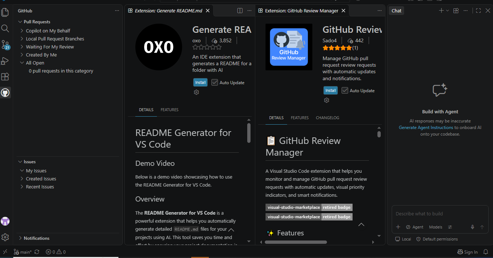
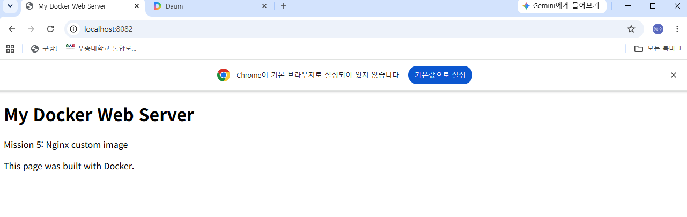

# 8단계. Git/GitHub 연동 및 제출 소스 재현 검증

## 1. 실습 개요

Git 작성자 정보와 기본 브랜치를 설정하고, GitHub 원격 저장소와
VS Code의 GitHub 계정 연결을 확인했다.

제출 저장소에 배치한 Dockerfile과 HTML로 이미지를 다시 빌드하고,
별도 컨테이너와 포트에서 웹 서버가 정상적으로 동작하는지 검증했다.

현재 커밋·푸시와 GitHub 웹의 최종 제출 확인은 진행 전이다.
실제 수행 후 해당 결과를 추가한다.

## 2. 실행 환경

| 항목 | 확인 결과 |
|---|---|
| Windows | Windows 10 Pro |
| Git 명령 실행 | Windows PowerShell |
| Git 버전 | 2.56.0.windows.4 |
| 편집 도구 | Visual Studio Code |
| Docker 작업 환경 | WSL2 Ubuntu |
| 로컬 저장소 | C:\Users\user\developer-workspace |
| 현재 브랜치 | main |
| 원격 저장소 | dongsoo-seol/developer-workspace |

## 3. Git 설정 확인

### 작성자 정보

현재 저장소에 작성자 이름과 이메일을 설정했다.
사용자가 로컬에서 설정 목록을 확인했으며, 개인정보 값은
대화와 보고서에 공개하지 않았다.

확인에 사용한 명령:

```powershell
git config --get user.name
git config --get user.email
```

### 새 저장소의 기본 브랜치

실행 명령:

```powershell
git config --global init.defaultBranch main
git config --global --get init.defaultBranch
```

실제 확인 출력:

```text
main
```

이 설정은 앞으로 새로 만드는 저장소의 기본값이다.
현재 저장소의 브랜치도 별도로 main임을 확인했다.

### 전체 설정 목록

확인에 사용한 명령:

```powershell
git --no-pager config --list
```

사용자가 설정 목록 확인을 완료했다.
제출용으로 마스킹한 실제 설정 출력은 추가로 기록한다.
이름·이메일·인증정보의 원문을 임의로 재작성하지 않는다.

## 4. 원격 저장소 연결

실행 명령:

```powershell
git remote -v
```

실제 확인 결과:

```text
origin  https://github.com/dongsoo-seol/developer-workspace.git (fetch)
origin  https://github.com/dongsoo-seol/developer-workspace.git (push)
```

준비된 자료는 별도 전달용 브랜치에서 가져왔다.

실행 명령:

```powershell
git fetch origin
git restore --source=origin/codex/submission-delivery-20261107 -- .
git status
```

실제 결과에서 README.md, Dockerfile, app, docs, examples 등의
새 파일을 확인했다.

Untracked files는 아직 커밋 대상으로 추가하지 않은 파일이라는
뜻이며 오류가 아니다.

전달용 브랜치의 커밋과 학습자가 main에 만드는 최종 커밋은
구분한다. 현재 자료 수신만으로 최종 제출이 끝난 것은 아니다.

## 5. VS Code와 GitHub 연결

다음 과정을 수행했다.

1. VS Code에서 developer-workspace 폴더를 열었다.
2. 소스 제어 화면에서 변경 파일 목록을 확인했다.
3. 공식 GitHub Pull Requests 확장을 확인했다.
4. 폴더의 Restricted Mode를 해제하고 과제 폴더를 신뢰했다.
5. 확장의 Sign in을 선택하고 GitHub 로그인을 허용했다.
6. 로그인 안내 대신 Pull Requests와 My Issues 목록이
   표시되는 것을 확인했다.

로그인 후 화면:



이미지 파일을 저장소의 docs/images 폴더로 복사한 결과,
08-vscode-github.png가 146,620바이트로 확인됐다.

## 6. 제출 소스를 이용한 재현 검증

### 작업 위치 확인

Windows 저장소 폴더에서 WSL Ubuntu를 실행했다.

```powershell
wsl -d Ubuntu
```

Ubuntu에서 확인한 명령:

```bash
pwd
ls -la
```

실제 현재 위치:

```text
/mnt/c/Users/user/developer-workspace
```

목록에서 Dockerfile, app, docs 등의 제출 파일을 확인했다.

### 이미지 빌드

재현 검증용으로 사용한 빌드 명령:

```bash
docker build -t mission-web:repro .
```

제공된 실제 빌드 출력에서 다음을 확인했다.

```text
CACHED [2/2] COPY app/ /usr/share/nginx/html/
naming to docker.io/library/mission-web:repro
unpacking to docker.io/library/mission-web:repro
```

위 출력은 핵심 부분만 발췌했다.
CACHED는 이전에 유효하게 만든 빌드 결과를 재사용했다는 뜻이다.

### 컨테이너 실행

기존 8080·8081번 포트와 구분하여 8082번을 사용했다.

실제 실행 명령:

```bash
docker run -d --name mission-web-repro -p 8082:80 mission-web:repro
docker ps
```

확인된 실행 상태:

| 항목 | 실제 결과 |
|---|---|
| 컨테이너 이름 | mission-web-repro |
| 컨테이너 ID | ffc5b7a375e8 |
| 이미지 | mission-web:repro |
| 상태 | Up 17 seconds |
| 포트 연결 | 8082 → 80 |

### HTTP 응답 확인

실제 실행 명령:

```bash
curl -i http://localhost:8082
```

실제 응답 헤더:

```text
HTTP/1.1 200 OK
Server: nginx/1.30.6
Date: Sat, 07 Nov 2026 14:43:08 GMT
Content-Type: text/html
Content-Length: 269
Last-Modified: Sat, 07 Nov 2026 13:08:11 GMT
Connection: keep-alive
ETag: "6aef22bb-10d"
Accept-Ranges: bytes
```

실제 응답 본문 중 발췌:

```html
<h1>My Docker Web Server</h1>
<p>Mission 5: Nginx custom image</p>
<p>This page was built with Docker.</p>
```

HTTP 200과 직접 작성한 HTML이 함께 확인됐다.
응답 시각은 한국 시각으로 2026-11-07 23:43:08이다.

이번 검증은 제출 소스로 웹 서버 기능을 재현한 결과이다.
이미지와 응답이 이전 실습과 바이트 단위로 완전히 같다는
검증으로 확대해서 설명하지 않는다.

### 브라우저 확인

Windows 브라우저에서 localhost:8082에 접속했다.
주소창과 직접 작성한 페이지가 함께 표시되는 것을 확인했다.



## 7. 재현 실습 자원 정리

실제 실행 명령:

```bash
docker stop mission-web-repro
docker rm mission-web-repro
```

두 명령에서 각각 확인한 출력:

```text
mission-web-repro
```

재현 실습용 컨테이너를 중지·삭제했다.

그 후 다음 명령으로 Ubuntu에서 PowerShell로 돌아왔다.

```bash
exit
```

실제 출력:

```text
logout
```

이후 PowerShell의 저장소 경로로 돌아온 것을 확인했다.

## 8. 수행 중 문제와 해결

### VS Code 실행 명령 미인식

- 문제: PowerShell에서 code 명령을 찾지 못했다.
- 확인: Windows 시작 메뉴에서는 VS Code가 검색됐다.
- 대안: 시작 메뉴로 VS Code를 실행하고 폴더 열기로
  과제 저장소를 열었다.
- 결과: 파일 목록과 소스 제어의 변경 사항을 확인했다.
- 범위: code 명령의 PATH 설정 자체를 수정하거나
  재검증한 것은 아니다.

### Restricted Mode로 일부 기능 제한

- 문제: VS Code에 Restricted Mode 안내가 표시됐다.
- 확인: Workspace Trust 화면에서 제한 상태를 확인했다.
- 해결: 과제 폴더에 Trust를 적용했다.
- 결과: You trust this folder가 표시됐고,
  이후 GitHub 로그인 화면과 인증 후 목록을 확인했다.

### 로그인 증거 이미지의 저장 위치 문제

- 문제: 지정한 저장소 경로에서 사진을 찾지 못했다.
- 확인: 파일 검색을 진행했고, 직접 경로 지정 복사도
  한 차례 실패했다.
- 해결: 실제 검색된 파일 객체를 사용해 대상 폴더로 복사했다.
- 결과: docs/images에서 08-vscode-github.png,
  146,620바이트를 확인했다.
- 범위: 앞선 검색 경로와 복사 실패가 불일치했던
  정확한 원인은 확정하지 않았다.

## 9. Git과 GitHub의 역할

| 구분 | Git | GitHub |
|---|---|---|
| 역할 | 로컬 변경 이력 관리 | 원격 저장소 보관과 협업 |
| 주요 작업 | add, commit, log | 원격 공유, PR, 이슈 |
| 관계 | 커밋을 로컬에 저장 | push로 커밋을 전달받음 |

작성자 이름·이메일 설정은 GitHub 로그인과 별개이다.
커밋만으로 GitHub 업로드가 완료되지는 않는다.

## 10. 최종 커밋·푸시 및 웹 확인

아직 실제 수행하지 않았다.
수행 후 다음 증거를 추가한다.

- 커밋 명령과 실제 결과
- 푸시 명령과 성공 결과
- GitHub 웹에서 파일과 커밋이 보이는 화면
- README의 문서·이미지 링크 확인 결과
- 과제 제출 규칙에 맞는 저장소 접근 권한 확인

## 11. 완료 체크리스트

- [x] Git 작성자 정보 설정 및 로컬 확인
- [x] 기본 브랜치 main 설정
- [x] 원격 저장소 연결 확인
- [x] VS Code의 GitHub 로그인 확인
- [x] 로그인 증거 이미지의 실제 저장 위치 확인
- [x] 제출 소스로 이미지 재빌드
- [x] 새 컨테이너에서 HTTP·브라우저 검증
- [x] 재현 실습용 컨테이너 정리
- [ ] 마스킹한 실제 Git 설정 출력 추가
- [ ] 이전 단계의 제출용 이미지 파일 배치 확인
- [ ] 본인 작성자 정보로 최종 커밋·푸시
- [ ] GitHub 웹에서 최종 파일·문서·이미지 확인
- [ ] 저장소 링크로 최종 제출