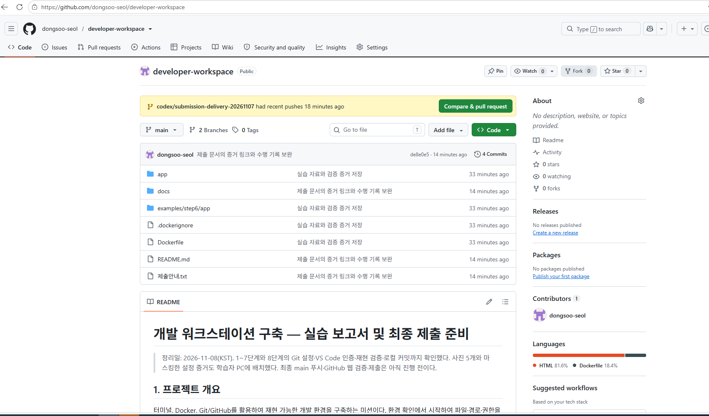

# 8단계. Git/GitHub 연동 및 제출 소스 재현 검증

> 정리일: 2026-11-08(KST). Git 설정·계정 연결·재현 검증·로컬 커밋까지 실제 확인했다. 문서 보완 커밋 de8e0e5의 main 푸시와 GitHub의 파일·사진 표시를 확인했다. 최종 저장소 화면은 학습자 PC에 저장했다.

## 1. 목표와 현재 결과

Git 작성자 정보와 기본 브랜치를 설정하고 원격 저장소·VS Code 계정 연결을 확인했다. 로컬 저장소에 넣은 제출 소스로 웹 서버를 다시 빌드해 HTTP 응답과 브라우저 접속을 검증하고 재현용 컨테이너를 정리했다. 보고서·소스·이미지 등 28개 파일을 로컬 커밋 1edb655로 보관했다.

아래 내용은 학습자가 제공한 실제 명령·출력, 화면, 수행 확인에 근거한다. 개인정보 값은 공유받지 않았으며 임의의 작성자 이름·이메일을 출력 예시로 만들지 않았다.

## 2. 실행 환경

| 항목 | 확인 결과 |
|---|---|
| OS | Windows 10 Pro |
| Git 명령 | Windows PowerShell, Windows Git 2.56.0.windows.4 |
| 편집기 | Windows Visual Studio Code |
| Docker 작업 | WSL2 Ubuntu / Docker Desktop |
| 저장소 | C:\Users\user\developer-workspace |
| WSL 경로 | /mnt/c/Users/user/developer-workspace |
| 현재 브랜치 | main |
| 원격 저장소 | dongsoo-seol/developer-workspace |

<a id="git-config"></a>

## 3. Git 설정과 안전한 출력 기록

작성자 이름·이메일을 현재 저장소에 설정했다. 학습자가 로컬 조회와 설정 목록 확인을 완료했다고 보고했다. 실제 개인정보 값은 보고서에서 공개하지 않는다.

확인에 사용한 명령:

```powershell
git config --get user.name
git config --get user.email
```

기본 브랜치 설정 및 확인:

```powershell
git config --global init.defaultBranch main
git config --global --get init.defaultBranch
```

실제 확인 출력:

```text
main
```

이 설정은 앞으로 만드는 저장소의 기본값이다. 기존 과제 저장소의 현재 브랜치 main은 git status에서도 별도로 확인했다.

전체 목록은 로컬에서 검토한 뒤, 제출용으로 필수 설정 행만 발췌하고 값을 가렸다.

실제 저장 명령:

```powershell
git --no-pager config --list | Select-String '^(user\.name|user\.email|init\.defaultbranch|remote\.origin\.(url|fetch))=' | ForEach-Object { $_ -replace '=.*$', '=[값 마스킹]' } | Set-Content -Encoding UTF8 .\docs\evidence\08-git-config-masked.txt
```

실제 저장 파일 조회 결과:

```text
init.defaultbranch=[값 마스킹]
init.defaultbranch=[값 마스킹]
remote.origin.url=[값 마스킹]
remote.origin.fetch=[값 마스킹]
user.name=[값 마스킹]
user.email=[값 마스킹]
```

[마스킹한 실제 설정 출력 파일](evidence/08-git-config-masked.txt)

두 번 나온 init.defaultbranch도 실제 출력 그대로 보존했다. 이 발췌에는 설정 출처가 표시되지 않으므로 각 행의 범위를 임의로 단정하지 않는다. main 값은 앞의 개별 조회 결과로 확인했다.

<a id="remote"></a>

## 4. 원격 연결과 자료 수신

실제 원격 조회:

```powershell
git remote -v
```

실제 출력:

```text
origin  https://github.com/dongsoo-seol/developer-workspace.git (fetch)
origin  https://github.com/dongsoo-seol/developer-workspace.git (push)
```

준비된 자료는 별도 전달용 브랜치에서 받아 main 작업 폴더에 배치했다.

```powershell
git fetch origin
git restore --source=origin/codex/submission-delivery-20261107 -- .
git status
```

fetch에서 새 원격 추적 브랜치를 확인했고, restore 후 README·Dockerfile·app·docs·examples 등이 Untracked files로 표시됐다. 이는 커밋에 아직 포함하지 않은 파일이라는 뜻이다.

전달용 브랜치의 보조 커밋을 학습자 자신의 최종 main 커밋으로 취급하지 않았다. 학습자는 본인 PC에서 작성자 설정 후 별도 커밋을 만들었다.

<a id="vscode"></a>

## 5. VS Code와 GitHub 연결

시작 메뉴로 VS Code를 실행해 과제 폴더를 열고 소스 제어의 변경 목록을 확인했다. 공식 게시자 GitHub의 GitHub Pull Requests 확장을 사용했다.

처음에는 Restricted Mode였으므로 과제 폴더에 Trust를 적용했다. You trust this folder를 확인한 뒤 확장 로그인 요청을 Allow로 허용했다. 인증 후 로그인 안내 대신 Pull Requests·My Issues 목록이 나타났다.


이미지 저장 위치를 찾는 과정에서 직접 경로를 지정한 복사가 실패했지만, 실제 검색된 파일 객체를 복사하여 대상 폴더에 146,620바이트 파일이 있는 것을 확인했다. 실패 원인을 숨은 문자나 특정 서비스 문제로 확정하지 않는다.

<a id="reproduction"></a>

## 6. 제출 소스를 이용한 웹 서버 재현

Windows 저장소에서 WSL Ubuntu를 열었다.

```powershell
wsl -d Ubuntu
```

Ubuntu에서 현재 위치와 제출 파일을 확인했다.

```bash
pwd
ls -la
```

실제 현재 위치:

```text
/mnt/c/Users/user/developer-workspace
```

### 이미지 빌드

재현에 안내되어 사용한 명령:

```bash
docker build -t mission-web:repro .
```

제공된 실제 빌드 출력 중 핵심 발췌:

```text
CACHED [2/2] COPY app/ /usr/share/nginx/html/
naming to docker.io/library/mission-web:repro
unpacking to docker.io/library/mission-web:repro
```

출력의 앞부분과 표시 간격은 생략했다. CACHED는 유효한 이전 빌드 결과를 재사용했다는 뜻이다.

### 컨테이너 실행

실제 실행 명령:

```bash
docker run -d --name mission-web-repro -p 8082:80 mission-web:repro
docker ps
```

기존 8080·8081과 구분하여 8082번을 사용했다.

| 항목 | 실제 결과 |
|---|---|
| 컨테이너 | mission-web-repro |
| ID | ffc5b7a375e8 |
| 이미지 | mission-web:repro |
| 상태 | Up 17 seconds |
| 포트 | 8082 → 80 |

### HTTP 요청과 응답

실제 요청:

```bash
curl -i http://localhost:8082
```

실제 응답 헤더:

```text
HTTP/1.1 200 OK
Server: nginx/1.30.6
Date: Sat, 07 Nov 2026 14:43:08 GMT
Content-Type: text/html
Content-Length: 269
Last-Modified: Sat, 07 Nov 2026 13:08:11 GMT
Connection: keep-alive
ETag: "6aef22bb-10d"
Accept-Ranges: bytes
```

실제 응답 본문 중 발췌:

```html
<h1>My Docker Web Server</h1>
<p>Mission 5: Nginx custom image</p>
<p>This page was built with Docker.</p>
```

HTTP 200뿐 아니라 작성한 HTML이 응답에 포함된 것을 확인했다. 응답 시각은 2026-11-07 23:43:08 KST이다. 보고서 정리일과 실제 실습 시각을 구분한다.


5단계의 257바이트와 달리 이번 응답은 269바이트였으며 실제 값을 그대로 기록했다. Windows 작업 파일의 줄바꿈 등으로 바이트 수는 달라질 수 있다. 이번 검증은 동일한 페이지 기능을 재현한 것이며 비트 단위로 동일한 이미지를 증명한 실험은 아니다.

<a id="cleanup"></a>

## 7. 재현 실습 자원 정리

실제 수행:

```bash
docker stop mission-web-repro
docker rm mission-web-repro
```

두 명령의 실제 출력은 각각 다음과 같았다.

```text
mission-web-repro
```

재현용 컨테이너를 중지·삭제했다. 이후 Ubuntu를 종료하고 PowerShell로 돌아왔다.

```bash
exit
```

실제 출력:

```text
logout
```

<a id="local-commit"></a>

## 8. 증거 파일 배치와 로컬 커밋

학습자 PC의 저장소에 다음 PNG 5개가 배치된 것을 파일 목록으로 확인했다.

| 파일 | 용도 | 제공된 크기 |
|---|---|---:|
| 05-web-access.png | 5단계 웹 접속 | 17,344바이트 |
| 06-bind-before.png | 바인드 수정 전 | 18,461바이트 |
| 06-bind-after.png | 바인드 수정 후 | 20,891바이트 |
| 08-vscode-github.png | VS Code GitHub 연결 | 146,620바이트 |
| 08-repro-web.png | 제출 소스 재현 | 35,542바이트 |

실제 파일 선택과 검토:

```powershell
git add README.md Dockerfile .dockerignore app docs examples 제출안내.txt
git --no-pager diff --cached --stat
```

실제 요약:

```text
28 files changed, 4975 insertions(+)
```

실제 커밋과 조회:

```powershell
git commit -m "실습 자료와 검증 증거 저장"
git --no-pager log -1 --oneline
```

실제 결과:

```text
[main 1edb655] 실습 자료와 검증 증거 저장
28 files changed, 4975 insertions(+)
1edb655 (HEAD -> main) 실습 자료와 검증 증거 저장
```

이 커밋은 문서 최종 수정 전의 보관용 커밋이다. 이후 문서 변경은 추가 커밋으로 남길 수 있다. 로컬 커밋 성공을 원격 푸시 성공으로 간주하지 않는다.

<a id="troubleshooting"></a>

## 9. 트러블슈팅

### code 명령 미인식

PowerShell에서 code 명령을 찾지 못했지만 시작 메뉴에서는 VS Code가 검색됐다. GUI로 실행하고 폴더 열기를 사용하여 저장소 파일과 소스 제어 목록을 확인했다. code 명령의 PATH 수정 자체를 재검증한 것으로 기록하지 않는다.

### Restricted Mode에서 일부 기능 제한

Workspace Trust의 제한 상태를 확인하고 과제 폴더에 Trust를 적용했다. You trust this folder를 확인한 뒤 공식 확장 로그인과 인증 후 목록을 확인했다.

### 자료 ZIP 다운로드 실패

아티팩트 다운로드가 실패하여 로컬 PC에서 ZIP을 찾을 수 없었다. 같은 UI를 반복하는 대신, 동의를 받고 별도 전달용 브랜치에 자료를 준비했다. Git fetch·restore로 실제 파일을 받아 새 파일 목록이 나타난 것을 확인했다. 이 오류를 GitHub 업로드 권한 문제와 혼동하지 않았다.

### 사진 저장 위치와 복사

지정 경로의 Test-Path가 False였고 직접 경로 복사도 실패했다. 파일을 검색한 뒤 실제 파일 객체를 복사하는 방식으로 해결하고 대상 폴더의 파일명·크기를 확인했다. 5·6단계 사진은 바탕 화면의 코디세이 폴더에서 찾아 함께 복사했다.

## 10. Git과 GitHub 역할

| 구분 | Git | GitHub |
|---|---|---|
| 역할 | 로컬 변경 이력 관리 | 원격 저장소 보관·협업 |
| 주요 작업 | add, commit, log | 원격 공유, PR, 이슈 |
| 관계 | 커밋을 로컬에 저장 | push로 커밋 전달 |

작성자 정보 설정과 GitHub 로그인은 별개이다. fetch로 받은 자료와 최종 main 푸시도 구분한다.

<a id="publication"></a>

## 11. main 푸시와 GitHub 웹 확인

문서 보완 커밋 de8e0e5를 생성한 뒤 다음 명령을 실행했다.

```powershell
git push origin main
```

실제 출력에서 전송 성공을 확인한 부분:

```text
info: please complete authentication in your browser...
Writing objects: 100% (50/50), 305.60 KiB | 5.27 MiB/s, done.
Total 50 (delta 12), reused 0 (delta 0), pack-reused 0 (from 0)
remote: Resolving deltas: 100% (12/12), done.
To https://github.com/dongsoo-seol/developer-workspace.git
   f89744e..de8e0e5  main -> main
```

인증 안내 뒤 실제 전송 성공 결과가 나왔다. GitHub에서 main의 파일 목록과 README 사진을 확인한 후 학습자는 “파일과 사진이 모두 보입니다”라고 보고했다. 원격 Git에서도 de8e0e5와 그 직전 커밋 1edb655를 확인했다. 원격 main의 PNG 5개도 로컬에서 기록한 파일 크기와 일치했다.

추가로 주소창·저장소 이름·파일 목록이 포함된 화면을 캡처하고 다음 파일로 저장했다고 보고했다.

```text
docs/images/08-github-repository.png
```



이 마지막 화면과 최종 확인 문서를 추가 커밋·푸시한다. 위 de8e0e5는 이미 확인한 게시 이력이며, 이후 문서 보완으로 최신 커밋이 바뀔 수 있다. 과제 제출처의 링크 등록과 평가자 접근 권한 확인은 별도로 수행한다.

## 12. 완료 체크리스트

- [x] Git 작성자·기본 브랜치 설정 확인
- [x] 실제 설정 출력의 필수 항목 발췌·마스킹·저장
- [x] 원격 저장소 연결과 전달용 자료 수신
- [x] VS Code GitHub 로그인과 증거 파일 배치
- [x] 제출 소스로 빌드·실행·HTTP·브라우저 검증
- [x] 재현 컨테이너 중지·삭제
- [x] 5·6·8단계 PNG 5개 실제 배치
- [x] 28개 파일의 로컬 커밋 1edb655 확인
- [x] 문서 보완 커밋 de8e0e5 확인
- [x] main 푸시 성공 및 GitHub 웹의 파일·사진 표시 확인
- [ ] 저장소 접근 권한과 최종 링크 제출

- [x] GitHub 저장소 화면 캡처의 PC 저장 확인
- [ ] 마지막 화면과 최종 확인 문서의 추가 커밋·푸시
